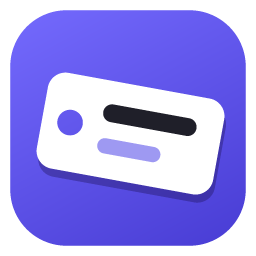
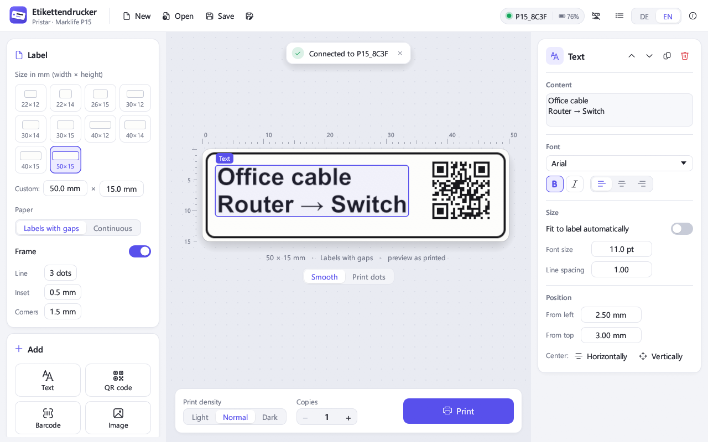
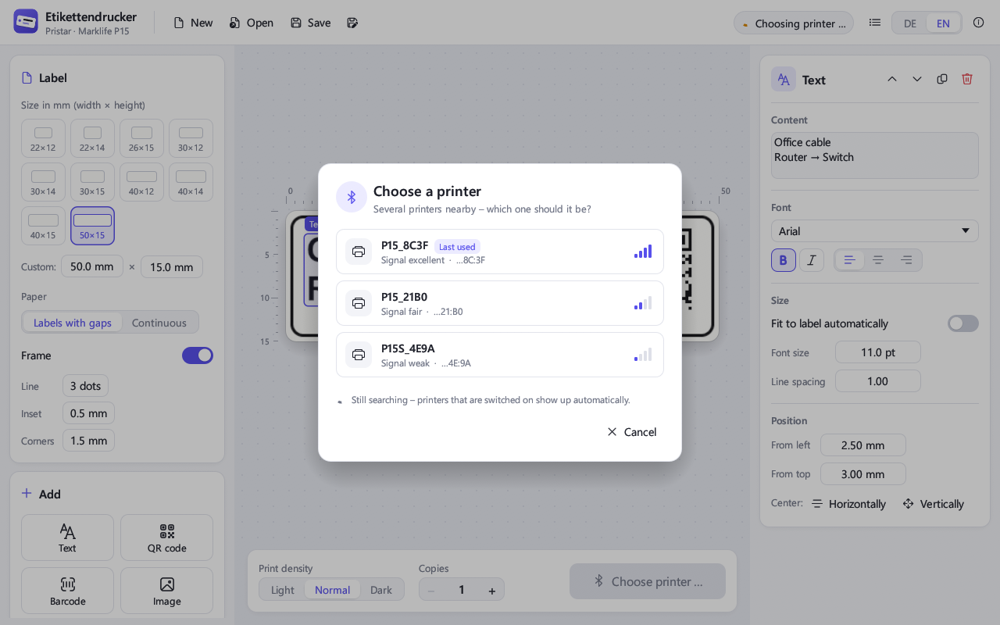
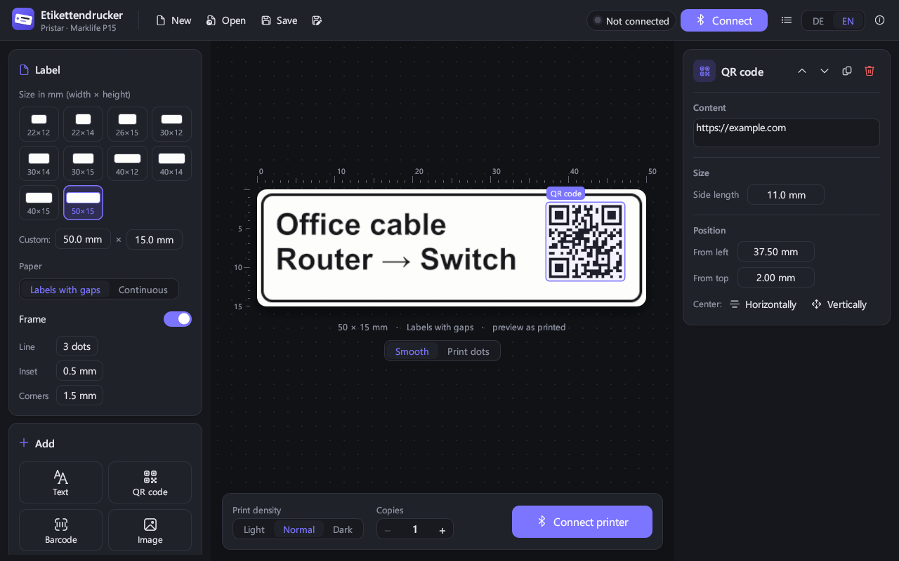

<p align="center">
  
</p>

<h1 align="center">Etikettendrucker</h1>

<p align="center">
  <b>Design and print labels on your Windows PC – for Pristar / Marklife P15 Bluetooth label printers.</b><br>
  No phone, no cloud, no account. A single .exe.
</p>

<p align="center">
  <a href="https://github.com/Nikiomedia/etikettendrucker/releases/latest"><b>⬇ Download for Windows</b></a>
  &nbsp;·&nbsp;
  <a href="README.md">🇩🇪 Deutsche Version</a>
</p>



Many cheap Bluetooth label printers only come with an app for iOS and Android.
This project brings the printer to your PC: with a large preview, all your Windows fonts,
templates you can save, and a printer picker in case several devices are nearby.

The interface is available in **English and German**. *Etikettendrucker* is simply German for “label printer”.

---

## Which printers work?

Many label printers sold online are **the same device under different brand names**.
This app supports the **“P15 family”**: small battery-powered thermal label printers with 203 dpi and
12–15 mm wide labels that are normally used with the **“Marklife”** app.

| Printer | Status |
|---|---|
| **Pristar P15** | ✅ Tested, prints perfectly |
| **Marklife P15** | ✅ Same hardware, fully working according to [thermoprint](https://github.com/tomLadder/thermoprint) |
| Marklife P15S, P15R, P7 and identical devices (names below) | 🟡 Same protocol, should work – not tested by me yet |
| Marklife P12 | ❌ Not yet – needs smaller data packets, could be added |
| Niimbot (D11, D110, B21 …), Phomemo (D30, M110 …), Brother P-touch, Dymo, Supvan/Katasymbol | ❌ No – these brands use completely different protocols |

### How to find out whether your printer fits

1. **Which app does the manual mention?** If it says “Marklife”, that is a very good sign.
2. **What is the printer's Bluetooth name?** You can see it in the Marklife app or in the Windows
   Bluetooth settings (just look, don't pair). The app recognizes printers whose name starts with:

   `P15` · `P15R` · `P15S` · `P7` · `LP15` · `iSPACE_LP15` · `S12` · `S15` · `P1s` · `M1` · `OUT_LPC` · `LPC74`

3. **Just try it.** The app only sends print data if the printer offers the matching Bluetooth service
   after connecting. If it speaks a different language, the app stops with a clear message.
   Nothing can break.

Your printer works but isn't in the list? Or it has a different name and isn't found?
I'd be happy about an [issue](https://github.com/Nikiomedia/etikettendrucker/issues) with the
model, the Bluetooth name and the contents of the log window.

---

## Features

- **Large, smooth preview** that looks like the printed label – with rulers in millimeters.
  “Print dots” shows every single dot (1/8 mm), for example to check very small text.
- **Text** in any installed Windows font, bold/italic, single or multiple lines, left/center/right.
  Optionally the size adjusts to the label automatically.
- **QR codes**, **barcodes** (Code 128, EAN-13) and **images** (PNG, JPG, BMP, GIF, WebP) –
  simply drag images into the window. Photos can be dithered.
- **Move things with the mouse**, with guides for centering; fine-tune with the arrow keys.
- **All P15 label sizes** as tiles, custom sizes freely adjustable, frame with rounded corners.
- **Print density** light/normal/dark, **multiple copies** in one go, progress shown in the print button.
- **Templates**: save and open them (`.etikett` files, images are embedded).
- **Printer battery level** in the header.
- **Light and dark mode**, follows your Windows setting.
- **English and German**, switch any time with **DE | EN** in the top right corner. On first start
  the app uses your Windows language and remembers your choice afterwards. Error messages and the
  log switch too.

### Several printers? No problem.



- When connecting, the app automatically picks the printer you **used last**.
- If only **one** matching printer is switched on, it connects right away.
- If **several** are nearby, a list appears with name, signal strength and the last digits of the
  Bluetooth address – so even two devices with the same name can be told apart.
- Clicking the status indicator in the top right opens the list at any time, also to switch printers.



---

## Usage

1. [Download `Etikettendrucker.exe`](https://github.com/Nikiomedia/etikettendrucker/releases/latest) and run it.
   No installation needed.
2. Turn the printer on. It must **not** be connected to the phone app or a browser tab at the same time.
3. Click **Connect**. From the second start on, the app connects by itself.
4. Pick a label size, add text, a QR code, a barcode or an image.
5. **Print**.

### Keyboard shortcuts

| Key | Action |
|---|---|
| Ctrl+P | Print |
| Ctrl+S | Save template |
| Ctrl+O | Open template |
| Del | Delete selected element |
| Arrow keys | Move element (0.25 mm, with Shift 1 mm) |

### If something doesn't work

- **Windows warns on first start (“Windows protected your PC”):**
  The .exe is not signed with a paid certificate. Click “More info” and then “Run anyway”.
  If you'd rather be on the safe side, build the app yourself (see below).
- **No printer found:** Is Bluetooth on? Is the printer switched on and disconnected from the phone app
  and the browser? Your PC needs Bluetooth 4.0 or newer.
- **Troubleshooting:** The list icon in the top right opens a log with all Bluetooth messages.
  “Copy” puts it on the clipboard so you can paste it into an issue.

Requirements: Windows 10 or 11 with Bluetooth Low Energy.

---

## How it works

The app is written in Rust (UI: [egui](https://github.com/emilk/egui),
Bluetooth: [btleplug](https://github.com/deviceplug/btleplug)). It needs no runtime.

This is how it talks to the printer:

- **Bluetooth LE**, service `FF00` with three characteristics: `FF02` (PC → printer), `FF01` (status messages)
  and `FF03` (flow control). No pairing.
- **Credit-based flow control:** The printer reports how many packets it can accept.
  Packets of 95 bytes are sent every 30 ms, just like the original app does.
- **Print image:** The label is drawn on the PC as a black-and-white image with 8 dots per mm,
  rotated by 90° (the print head runs across the short side) and sent as the raster command `GS v 0`.
  The printer has no fonts of its own.

| File | Contents |
|---|---|
| `src/protocol.rs` | Printer byte sequences (raster image, feed, status messages) |
| `src/printer.rs` | Bluetooth scan, printer picker, connection with flow control |
| `src/render.rs` | Draws the label – as print image and as smooth preview |
| `src/model.rs` | Data model, saved as template |
| `src/app.rs` | User interface |
| `src/ui_kit.rs` | Design system: colors, fonts, custom widgets |
| `src/i18n.rs` | Language switch – every text is a pair `tr("Deutsch", "English")` right in the code |

### Building it yourself

Requirements: [Rust](https://rustup.rs) with the MSVC toolchain (Windows).

```bash
cargo build --release
```

The finished file is `target/release/etikettendrucker.exe`.

- `cargo test` checks the protocol bytes and label rendering.
- `cargo run --example make_icon` regenerates the app icon (`assets/icon.ico`).

---

## Thanks & license

The knowledge about the print protocol comes from the excellent open-source project
[thermoprint](https://github.com/tomLadder/thermoprint) by tomLadder (MIT license) –
which also has a label editor for the browser.

This app is released under the [MIT license](LICENSE). It is **not an official product** of Pristar or
Marklife; all brand names belong to their respective owners.
