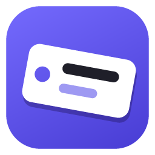
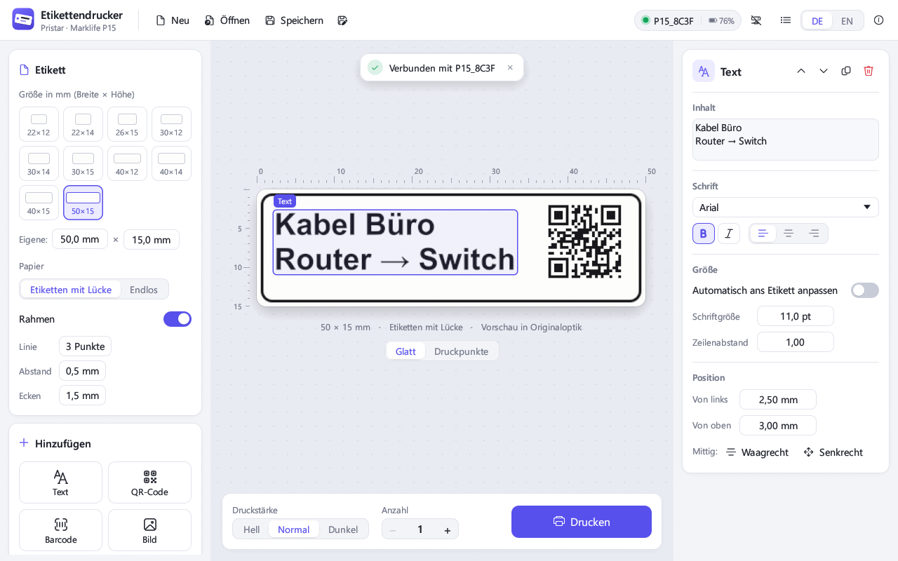
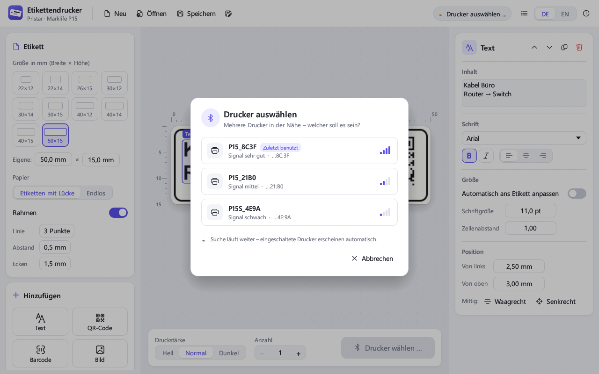
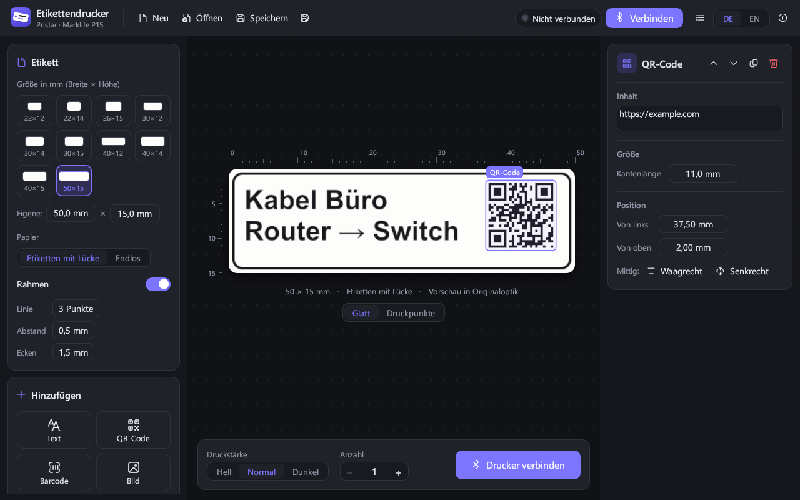

<p align="center">
  
</p>

<h1 align="center">Etikettendrucker</h1>

<p align="center">
  <b>Etiketten am Windows-PC gestalten und drucken – für Bluetooth-Etikettendrucker der Reihe Pristar / Marklife P15.</b><br>
  Kein Handy, keine Cloud, kein Konto. Eine einzige .exe.
</p>

<p align="center">
  <a href="https://github.com/Nikiomedia/etikettendrucker/releases/latest"><b>⬇ Download für Windows</b></a>
  &nbsp;·&nbsp;
  <a href="README.en.md">🇬🇧 English version</a>
</p>



Für viele günstige Bluetooth-Etikettendrucker gibt es nur eine App für iOS und Android.
Dieses Projekt bringt den Drucker an den PC: mit großer Vorschau, allen Windows-Schriften,
Vorlagen zum Speichern und einer Druckerauswahl, falls mehrere Geräte in der Nähe sind.
Die Oberfläche gibt es auf **Deutsch und Englisch**.

---

## Welche Drucker funktionieren?

Viele Etikettendrucker aus dem Online-Handel sind **dasselbe Gerät unter verschiedenen Markennamen**.
Diese App unterstützt die **„P15-Familie“**: kleine Thermo-Etikettendrucker mit Akku, 203 dpi und
12–15 mm breiten Etiketten, die normalerweise mit der App **„Marklife“** benutzt werden.

| Drucker | Stand |
|---|---|
| **Pristar P15** | ✅ Getestet, druckt einwandfrei |
| **Marklife P15** | ✅ Baugleich, laut [thermoprint](https://github.com/tomLadder/thermoprint) voll funktionsfähig |
| Marklife P15S, P15R, P7 und baugleiche Geräte (Namen siehe unten) | 🟡 Gleiches Protokoll, sollte funktionieren – noch nicht selbst getestet |
| Marklife P12 | ❌ Noch nicht – braucht kleinere Datenpakete, wäre aber nachrüstbar |
| Niimbot (D11, D110, B21 …), Phomemo (D30, M110 …), Brother P-touch, Dymo, Supvan/Katasymbol | ❌ Nein – diese Marken sprechen ganz andere Protokolle |

### So findest du heraus, ob dein Drucker passt

1. **Welche App steht in der Anleitung?** Heißt sie „Marklife“, ist das ein sehr gutes Zeichen.
2. **Wie heißt der Drucker per Bluetooth?** Der Name steht in der Marklife-App oder in den
   Bluetooth-Einstellungen von Windows (nur ansehen, nicht koppeln). Die App erkennt Drucker,
   deren Name so beginnt:

   `P15` · `P15R` · `P15S` · `P7` · `LP15` · `iSPACE_LP15` · `S12` · `S15` · `P1s` · `M1` · `OUT_LPC` · `LPC74`

3. **Einfach ausprobieren.** Die App sendet nur dann Druckdaten, wenn der Drucker nach dem Verbinden
   den passenden Bluetooth-Dienst anbietet. Spricht er eine andere Sprache, bricht sie mit einer
   verständlichen Meldung ab. Kaputtgehen kann dabei nichts.

Dein Drucker funktioniert, steht aber nicht in der Liste? Oder er heißt anders und wird nicht gefunden?
Dann freue ich mich über ein [Issue](https://github.com/Nikiomedia/etikettendrucker/issues) mit
Modell, Bluetooth-Name und dem Inhalt des Protokollfensters.

---

## Funktionen

- **Große, glatte Vorschau**, die so aussieht wie das gedruckte Etikett – mit Linealen in Millimetern.
  Mit „Druckpunkte“ siehst du jeden einzelnen Punkt (1/8 mm), etwa um sehr kleine Schrift zu prüfen.
- **Text** in jeder installierten Windows-Schrift, fett/kursiv, ein- oder mehrzeilig, links/mittig/rechts.
  Auf Wunsch passt sich die Größe automatisch ans Etikett an.
- **QR-Codes**, **Barcodes** (Code 128, EAN-13) und **Bilder** (PNG, JPG, BMP, GIF, WebP) –
  Bilder einfach ins Fenster ziehen. Fotos werden auf Wunsch gerastert.
- **Mit der Maus verschieben**, mit Hilfslinien zum Zentrieren; Feinjustierung mit den Pfeiltasten.
- **Alle Etikettengrößen der P15** als Kacheln, eigene Größen frei einstellbar, Rahmen mit runden Ecken.
- **Druckstärke** hell/normal/dunkel, **mehrere Kopien** am Stück, Fortschritt im Druckknopf.
- **Vorlagen** speichern und öffnen (`.etikett`-Dateien, Bilder sind darin enthalten).
- **Akkustand** des Druckers in der Kopfzeile.
- **Helles und dunkles Design**, folgt der Windows-Einstellung.
- **Deutsch und Englisch**, umschaltbar oben rechts mit **DE | EN**. Beim ersten Start nimmt die App
  die Sprache von Windows, danach merkt sie sich deine Wahl. Auch Fehlermeldungen und das Protokoll
  wechseln mit.

### Mehrere Drucker? Kein Problem.



- Beim Verbinden nimmt die App automatisch den **zuletzt benutzten** Drucker.
- Ist nur **ein** passender Drucker an, verbindet sie sich direkt.
- Sind **mehrere** in der Nähe, erscheint eine Auswahl mit Name, Signalstärke und den letzten
  Stellen der Bluetooth-Adresse – so lassen sich auch zwei gleich heißende Geräte unterscheiden.
- Ein Klick auf die Statusanzeige oben rechts öffnet die Auswahl jederzeit, auch um zu wechseln.



---

## Benutzung

1. [`Etikettendrucker.exe` herunterladen](https://github.com/Nikiomedia/etikettendrucker/releases/latest) und starten.
   Eine Installation ist nicht nötig.
2. Drucker einschalten. Er darf **nicht gleichzeitig** mit der Handy-App oder einem Browser-Tab verbunden sein.
3. **Verbinden** klicken. Ab dem zweiten Start verbindet sich die App von selbst.
4. Etikettengröße wählen, Text, QR-Code, Barcode oder Bild hinzufügen.
5. **Drucken**.

### Tastenkürzel

| Taste | Wirkung |
|---|---|
| Strg+P | Drucken |
| Strg+S | Vorlage speichern |
| Strg+O | Vorlage öffnen |
| Entf | Ausgewähltes Element löschen |
| Pfeiltasten | Element verschieben (0,25 mm, mit Umschalt 1 mm) |

### Wenn etwas nicht klappt

- **Windows warnt beim ersten Start („Der Computer wurde durch Windows geschützt“):**
  Die .exe ist nicht kostenpflichtig signiert. Auf „Weitere Informationen“ und dann „Trotzdem ausführen“ klicken.
  Wer lieber auf Nummer sicher geht, baut die App selbst (siehe unten).
- **Kein Drucker gefunden:** Ist Bluetooth am PC an? Ist der Drucker eingeschaltet und von Handy-App
  und Browser getrennt? Der PC braucht Bluetooth 4.0 oder neuer.
- **Fehlersuche:** Das Listen-Symbol oben rechts öffnet ein Protokoll mit allen Bluetooth-Meldungen.
  Über „Kopieren“ lässt es sich in ein Issue einfügen.

Voraussetzung: Windows 10 oder 11 mit Bluetooth Low Energy.

---

## Technik

Die App ist in Rust geschrieben (Oberfläche: [egui](https://github.com/emilk/egui),
Bluetooth: [btleplug](https://github.com/deviceplug/btleplug)). Sie kommt ohne Laufzeitumgebung aus.

So spricht sie mit dem Drucker:

- **Bluetooth LE**, Dienst `FF00` mit drei Kanälen: `FF02` (PC → Drucker), `FF01` (Statusmeldungen)
  und `FF03` (Flusssteuerung). Gekoppelt wird nicht.
- **Flusssteuerung mit Credits:** Der Drucker teilt mit, wie viele Pakete er annehmen kann.
  Gesendet werden Pakete zu 95 Byte im 30-ms-Takt, genau wie in der Original-App.
- **Druckbild:** Das Etikett wird am PC als Schwarz/Weiß-Bild mit 8 Punkten pro mm gezeichnet,
  um 90° gedreht (der Druckkopf läuft über die kurze Seite) und als Rasterbefehl `GS v 0` gesendet.
  Der Drucker hat keine eigenen Schriften.

| Datei | Inhalt |
|---|---|
| `src/protocol.rs` | Bytefolgen des Druckers (Rasterbild, Vorschub, Statusmeldungen) |
| `src/printer.rs` | Bluetooth-Suche, Druckerauswahl, Verbindung mit Flusssteuerung |
| `src/render.rs` | Zeichnet das Etikett – als Druckbild und als geglättete Vorschau |
| `src/model.rs` | Datenmodell, wird als Vorlage gespeichert |
| `src/app.rs` | Oberfläche |
| `src/ui_kit.rs` | Design-System: Farben, Schriften, eigene Bedienelemente |
| `src/i18n.rs` | Sprachumschaltung – jeder Text steht als Paar `tr("Deutsch", "English")` direkt im Code |

### Selbst bauen

Voraussetzung: [Rust](https://rustup.rs) mit der MSVC-Toolchain (Windows).

```bash
cargo build --release
```

Die fertige Datei liegt unter `target/release/etikettendrucker.exe`.

- `cargo test` prüft Protokoll-Bytes und das Zeichnen der Etiketten.
- `cargo run --example make_icon` erzeugt das App-Symbol (`assets/icon.ico`) neu.

---

## Danke & Lizenz

Das Wissen über das Druckprotokoll stammt aus dem großartigen Open-Source-Projekt
[thermoprint](https://github.com/tomLadder/thermoprint) von tomLadder (MIT-Lizenz) –
dort gibt es auch einen Etiketten-Editor für den Browser.

Diese App steht unter der [MIT-Lizenz](LICENSE). Sie ist **kein offizielles Produkt** von Pristar oder
Marklife; alle Markennamen gehören ihren jeweiligen Inhabern.
